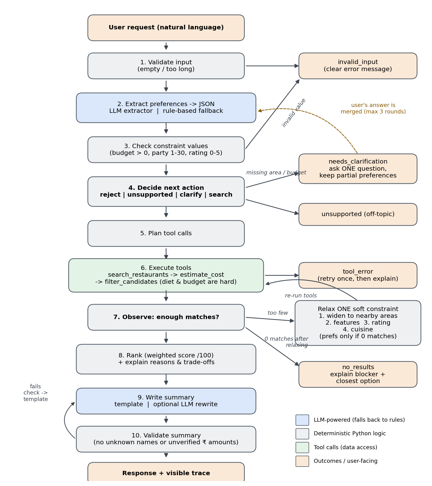

# Agent Workflow and Architecture

## Why this is an agent, not a chatbot
A chatbot answers in one step. This agent **decides what to do next** based on what it observes:
it asks a question when essential information is missing, chooses which tools to call, checks how
many results came back, and **re-plans** (widens the area or relaxes one preference) when the
results are not good enough. Every step is written to a visible trace.

## What is AI and what is ordinary Python
| Stage | Implementation | Why |
|---|---|---|
| Understand request -> JSON | **LLM** (falls back to rules) | Free text is varied; an LLM handles phrasing that regex misses |
| Validate LLM output | Python | An LLM can invent values; we only accept known areas/cuisines/features |
| Decide / plan / relax | Python rules | Decisions must be predictable and testable |
| Tools (search, cost, filter) | Python | Budget maths must be exact, never "approximately" right |
| Rank + explain | Python weighted score | Explanations are generated from the same numbers as the score |
| Friendly summary | **LLM** (optional) | Better wording; checked for invented names/prices before use |

In DEMO mode (no API key) the two LLM stages use the rule-based extractor and a template.

## Modules
| File | Responsibility |
|---|---|
| `agent/extractor.py` | Input validation; rule-based, LLM and hybrid preference extraction |
| `agent/planner.py` | Decide (reject / unsupported / clarify / search); plan; choose next relaxation |
| `agent/tools.py` | Tools: `search_restaurants`, `get_nearby_areas`, `estimate_cost`, `check_budget`, `filter_candidates`; ToolBox with retry + logging |
| `agent/recommender.py` | Weighted scoring, reasons and trade-offs |
| `agent/response_generator.py` | Template summary, optional LLM summary, hallucination check |
| `agent/llm.py` | Minimal OpenAI-compatible / Anthropic client (standard library only) |
| `agent/core.py` | `DiscoveryAgent` orchestrator and `ConversationState` |
| `agent/models.py` | Dataclasses passed between stages |

## Decision rules
* **Hard constraints** (never relaxed): diet, budget. "Vegetarian" = pure-veg restaurant.
* **Clarify** if the area or budget is missing, or the area is not covered. One question per turn,
  at most 3 rounds; after that the agent proceeds and lists its assumptions.
* **Relaxation order:** nearby areas (<= 8 km, Dijkstra over an area graph) -> features -> rating -> cuisine.
  Widening the area is allowed whenever fewer than 3 match. A stated preference is changed only
  when **zero** restaurants match, and only if it actually rejected candidates.
* **Cost estimate:** average cost per person x party size x 1.05 (assumed 5% GST), rounded to ₹10.
  Party size defaults to 2 (stated as an assumption).
* **Score (/100):** rating 30%, occasion 20%, cuisine 15%, distance 15%, value-for-money 10%, features 10%.

## Failure handling
| Situation | Behaviour |
|---|---|
| Empty / >500-char input | `invalid_input` |
| Budget <= 0, party > 30, rating outside 0-5 | `invalid_input` with the specific reason |
| Off-topic request | `unsupported` with an example of a valid request |
| Data file missing/corrupt | Retry once, then `tool_error`; no invented results |
| LLM API error / bad JSON | Rule-based extractor takes over; trace records the fallback |
| LLM summary invents a name or price | Rejected; template summary used |
| Nothing matches | `no_results`, names the blocking hard constraint and the closest option |
